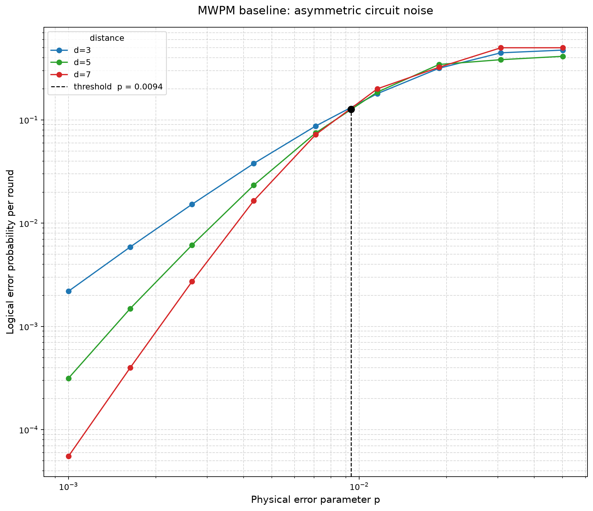

# neural-network-qec

An early research scaffold for studying decoders for quantum error correction.
The current implementation does not yet contain a neural network. It builds
configurable Stim rotated surface-code memory circuits, samples detector events
and logical observables, and evaluates a PyMatching minimum-weight perfect
matching (MWPM) baseline.

## Research direction

I built this to learn how a neural-network decoder for quantum error correction
can be tested against a matching baseline on the rotated surface code. This is
my self-taught research project: I write the research implementation by hand,
using explanations, hints, and code review to check my understanding.
I wrote the direct sweep first to understand circuit construction, sampling,
decoding, and error counting before using Sinter to manage experiments.

A detector event records a change in a stabilizer measurement. The decoder
uses those events to predict whether the encoded logical value flipped.
The logical error rate is the fraction of trials where that prediction is
wrong. Matching uses the circuit's detector error model to choose likely error
paths. Comparing distances under the same noise settings lets me inspect
whether larger codes suppress those errors. The current implementation is the
matching baseline; a learned decoder and its comparison remain future work.

My planned research sequence is:

1. Save the threshold figure, then build seeded training, validation,
   calibration, and test splits at distance 3. Train a small hand-written MLP
   (a fully connected neural network), and compare it with matching on the same
   shots using a paired McNemar test, which counts where only one decoder fails.
2. Study mechanisms and confidence: vary the fraction of error mechanisms that
   trigger more than two detectors, check whether predicted confidence matches
   observed accuracy, and investigate conformal risk control for abstention
   (declining uncertain predictions), including assumptions needed for an error
   bound.
3. Explore noise drift (changes between training and test noise), distance 5,
   and validation on real Google Willow data.

These are research goals, not implemented features or established guarantees.
I expect stronger measurement/reset noise to lower the threshold, and still
need matched uniform/asymmetric sweeps to test that prediction. The current
manual sweep uses the asymmetric `p`/`10p` model described below; its crossing
is an exploratory finite-distance estimate with no uncertainty interval.

## Setup

The project requires Python 3.12 and uses `uv` with locked Stim, PyMatching,
Sinter, NumPy, pandas, and Matplotlib dependencies. This checkout keeps its
virtual environment outside the OneDrive-synced project folder at
`~/.venvs/neural-network-qec`. The tracked `.envrc` sets that location
automatically for `direnv` users; it can also be exported manually:

```sh
export UV_PROJECT_ENVIRONMENT=~/.venvs/neural-network-qec
uv sync --extra dev
```

The `dev` extra currently declares pytest only. Ruff and basedpyright commands
therefore require those tools to be available separately in the environment
that runs them.

## Direct threshold sweep

Run the direct PyMatching sweep as a package module:

```sh
uv run python -m neural_network_qec.normal_sweep
```

The module evaluates nine logarithmically spaced physical error rates from
`0.001` through approximately `0.0501` at code distances 3, 5, and 7, with the
number of syndrome rounds equal to the distance. For each point, it applies
`p` to data and Clifford depolarization and `10p` to measurement and reset
flips:

- `before_round_data_depolarization`
- `before_measure_flip_probability`
- `after_clifford_depolarization`
- `after_reset_flip_probability`

The call is `circuit_info(d, d, p, p * 10, p, p * 10)`: `rounds = d`,
`distance = d`, data/Clifford depolarization `p`, and measurement/reset flips
`10p`. This is the asymmetric 10x noise model.

For each of the 27 `(p, distance)` points it samples 1,000,000 shots, builds a
decomposed detector error model, decodes with PyMatching, and measures logical
observable mismatches. It converts the per-shot logical error rate `L` to the
equivalent per-round rate
`0.5 * (1 - (1 - 2L) ** (1 / rounds))`, stores the results in a pandas
DataFrame, and prints adjacent-distance suppression ratios.

`threshold_plot()` draws the distance curves on log-log axes. It linearly
interpolates sign changes between adjacent curves in log space and reports the
geometric mean of the pairwise crossings as the threshold estimate. The sweep
is unseeded and `plt.show()` opens an interactive plot, so numerical results
vary between runs and the command requires a graphical Matplotlib backend.

## Measured threshold figure



This unseeded run completed all 27 points: distances 3, 5, and 7; nine physical
error parameters; and 1,000,000 shots per point. The reported crossing estimate
was `p ≈ 0.00939` under the current asymmetric `p`/`10p` model. It is a
finite-distance interpolation with no confidence interval, not a measured
comparison with uniform noise or a trained neural decoder.

The presentation export keeps the same measured curves and crossing calculation;
it only clarifies labels and removes an overlapping duplicate annotation.
[Measured points](docs/assets/normal-sweep-results.csv) and
[figure provenance](docs/assets/README.md) accompany the image. The module's
default command still opens the interactive Matplotlib plot; file capture does
not change its simulation settings.

## Adaptive Sinter sweep

The separate Sinter workflow can resume a larger adaptive experiment:

```sh
uv run python -m neural_network_qec.sinter_sweep
```

It creates 81 tasks from distances 3, 5, and 7; nine physical error rates from
`0.001` through approximately `0.0200`; and syndrome-round counts of `d`, `2d`,
and `3d`. It uses the same asymmetric `p`/`10p` noise model and PyMatching
decoder, runs with six workers, and stops each task at 1,000,000 shots or 1,000
logical errors. Progress is resumed into
`data/sinter_asymmetric_10x.csv`. The `data/` directory is intentionally ignored
because experiment output can be large.

The same pipeline is available through the Python API:

```python
import numpy as np
import pymatching

from neural_network_qec.circuit import circuit_info

circuit = circuit_info(
    rounds=3,
    distance=3,
    before_round_data_depolarization=0.005,
    before_measure_flip_probability=0.005,
    after_clifford_depolarization=0.005,
    after_reset_flip_probability=0.005,
)
detector_events, observables = circuit.sample_detectors(shots=10)
model = circuit.detector_error_model()
matcher = pymatching.Matching.from_detector_error_model(model)
predictions = matcher.decode_batch(detector_events)
logical_error_rate = np.mean(np.any(predictions != observables, axis=1))
```

For the distance-3, three-round configuration, ten shots produce Boolean
detector and observable arrays with shapes `(10, 24)` and `(10, 1)`; PyMatching
returns predictions with shape `(10, 1)`.

## Saved Sinter data and exploratory inspection

`sinter_asymmetric_10x.csv` is the explicitly published research snapshot at
the repository root. It contains 705 batch rows representing 81 tasks and
8,078,241 total shots. It is separate from the ignored live resume file under
`data/`. Repeated rows belong to adaptive simulation batches; counts must be
summed for each full task identity before calculating a task's error rate.

```sh
uv run python 'src/neural_network_qec/threshold_plot(sinter_sweep).py'
```

Despite its filename, this script currently expands JSON metadata and prints
first grouped values. It does not plot a threshold or aggregate batches, and
its `(d, p)` grouping mixes different round counts. Treat its output as a
metadata inspection rather than a statistical result.

## Circuit diagrams

I wrote `viz.py` to connect my WSL terminal workflow to a browser: Stim returns
SVG, HTML, or text source, and printing that source in a terminal does not
render a rich diagram. The helper writes the result to a file, prefers Windows
temporary storage when running under WSL, translates the path for the Windows
browser, and falls back to printing a path when opening is unavailable. Its
separate `threshold_plot()` helper plots the measured logical-error curves.
Keeping the viewer in the package also avoids relying on the earlier private,
machine-local `vizshow` helper recorded in the development history.

`circuit_info.circuit_diagram()` renders a Stim diagram to a timestamped SVG or
HTML file and tries to open it with the platform's browser tooling:

```python
path = circuit.circuit_diagram(kind="timeline-svg", name="circuit")
```

Set `QEC_VIZ_NO_OPEN=1` to write without opening a browser, and set
`QEC_VIZ_DIR` to choose the output directory. Otherwise, output is written
under a temporary `qec-viz` directory (or the Windows temporary directory when
it can be resolved from WSL). Generated diagrams are local output and are not
tracked.

## Layout

```text
src/neural_network_qec/
    __init__.py    package version metadata
    circuit.py     Stim circuit, sampling, diagram, and error-model API
    normal_sweep.py  direct MWPM probability sweep and threshold estimate
    sinter_sweep.py  resumable adaptive Sinter experiment
    viz.py           Stim diagram viewer and threshold plotting helper
    threshold_plot(sinter_sweep).py  exploratory Sinter metadata inspection
tests/
    test_packaging.py  package and declared-entry-point regression checks
pyproject.toml     package, dependency, and tool configuration
uv.lock            reproducible dependency lock
```

Generated diagrams under `diagrams/`, root scratch files `test.py` and
`test_1.py`, virtual environments, bytecode, and tool caches are intentionally
ignored and are not part of the tracked project snapshot. The root
`logs.md` journal is also local-only and ignored; it is not distributed with
the published source.

## Current limitations

- `normal_sweep.py` runs at import time, has fixed experiment parameters, and
  has no command-line interface or reproducible seed.
- The per-round conversion assumes independent, identical logical round flips.
  It becomes sensitive to sampling fluctuations when the per-shot rate approaches
  0.5; clipping at 0.5 avoids invalid real roots but does not quantify uncertainty.
- Its default run samples 27 million shots in total and keeps a one-million-shot
  detector batch in memory for each point. It does not persist the DataFrame or
  calculate confidence intervals.
- `sinter_sweep.py` uses a relative results path, so it must be run from the
  repository root to resume the intended `data/sinter_asymmetric_10x.csv` file.
- The asymmetric noise-model label and output filename are written separately
  from the four numerical noise arguments, so future parameter edits must keep
  them synchronized manually.
- The tracked tests cover package/entry-point integrity only; they do not yet
  test the circuit, decoder, threshold interpolation, or experiment numerics.
- Neural-network training, learned decoding, evaluation, and benchmarking
  against the MWPM baseline are not implemented yet.

## Offline use

After the locked dependencies are installed, circuit construction, sampling,
MWPM decoding, and file-based diagram rendering work locally. A first
installation or uncached dependency update needs access to PyPI, and a push
needs access to GitHub.
